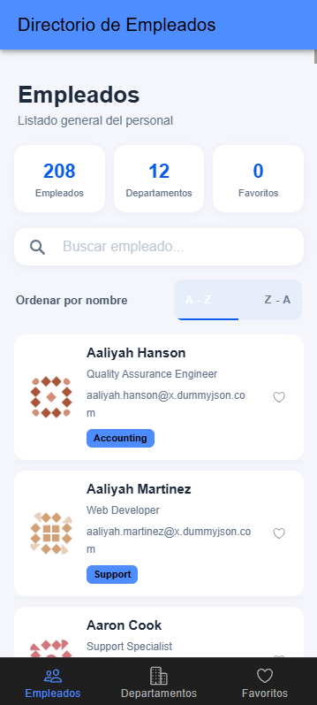
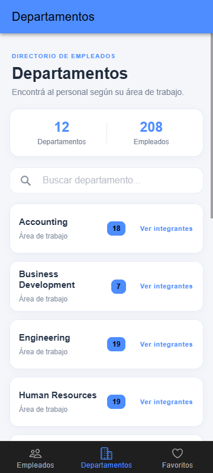
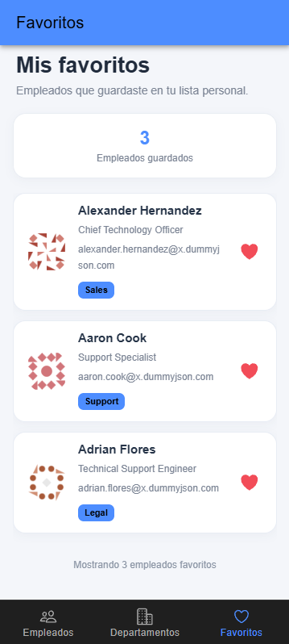

# Directorio de Empleados

Aplicación desarrollada con **Ionic, Angular y Capacitor** para
consultar un directorio de empleados, explorar su organización por
departamentos y guardar empleados favoritos.

**Autor:** Lucas Lezcano\
**Repositorio:** https://github.com/lucaslezcano03/directorio-empleados

------------------------------------------------------------------------

## Descripción

Directorio de Empleados es una aplicación con tres secciones
principales:

-   **Empleados:** muestra el listado general del personal con
    fotografía, nombre, cargo, correo electrónico y departamento.
-   **Departamentos:** organiza los empleados según el departamento al
    que pertenecen y permite expandir o contraer cada grupo.
-   **Favoritos:** reúne los empleados marcados por el usuario y permite
    quitarlos de esa lista.

La aplicación consume información en formato JSON desde una API REST y
utiliza almacenamiento local para conservar los identificadores de los
empleados favoritos.

## Funcionalidades

### Empleados

-   Consulta los empleados desde la API.
-   Muestra fotografía, nombre, cargo, correo y departamento.
-   Permite buscar por nombre, apellido, correo electrónico o
    departamento.
-   Permite ordenar alfabéticamente de A a Z y de Z a A.
-   Muestra un resumen con la cantidad de empleados, departamentos y
    favoritos.
-   Permite agregar o quitar empleados de favoritos.
-   Presenta estados de carga, mensajes de error y una opción para
    reintentar la consulta.

### Departamentos

-   Agrupa los empleados por departamento.
-   Ordena los departamentos alfabéticamente.
-   Permite expandir y contraer cada departamento.
-   Muestra estados de carga y mensajes de error.

### Favoritos

-   Muestra los empleados guardados como favoritos.
-   Permite quitar empleados de la lista.
-   Recupera los favoritos guardados al volver a entrar en la pestaña.

## Tecnologías utilizadas

| Tecnología | Versión | Uso |
|---|---|---|
| Ionic Angular | ^9.0.0 | Componentes e interfaz |
| Angular | 22.2.6 | Framework |
| Angular CLI / Build | 22.2.7 | Desarrollo y compilación |
| TypeScript | ~6.0.0 | Lenguaje de programación |
| Capacitor Core | 8.6.2 | Integración nativa |
| Capacitor CLI | 8.6.2 | Herramientas de Capacitor |
| Capacitor Preferences | ^8.0.1 | Persistencia local |
| RxJS | ~7.8.0 | Operaciones asíncronas |
| Ionicons | ^8.1.0 | Iconografía |
| Capacitor Android | ^8.6.2 | Plataforma nativa para generar la aplicación Android |

> Las versiones indicadas corresponden a las dependencias declaradas en
> el `package.json` compartido para la documentación.

## Fuente de datos

La aplicación utiliza **DummyJSON** como fuente de datos de empleados:

-   Endpoint: https://dummyjson.com/users
-   Consulta utilizada por el servicio: `?limit=0`, para solicitar el
    conjunto completo de usuarios disponible en el endpoint.

El servicio `EmpleadosService` utiliza `HttpClient` de Angular y obtiene
la dirección base desde la configuración de `environment.apiUrl`.

Los datos utilizados por la interfaz incluyen identificador, nombre,
apellido, correo, fotografía, cargo y departamento.

## Almacenamiento local

Los empleados se obtienen desde la API. En cambio, los favoritos se
guardan localmente mediante el complemento **Capacitor Preferences**.

El servicio `FavoritosService` almacena los identificadores de los
empleados favoritos bajo la clave `empleados-favoritos`. De esta manera,
la selección puede recuperarse cuando se vuelve a abrir la aplicación.

## Organización del proyecto

La estructura principal del código fuente se organiza de la siguiente
manera:

``` text
directorio-empleados/
├── android/
│   ├── app/
│   │   ├── src/
│   │   └── build.gradle
│   ├── gradle/
│   │   └── wrapper/
│   ├── build.gradle
│   ├── gradle.properties
│   ├── gradlew
│   ├── gradlew.bat
│   └── settings.gradle
├── docs/
│   └── capturas/
│       ├── empleados.png
│       ├── departamentos.png
│       └── favoritos.png
├── src/
│   ├── app/
│   │   ├── models/
│   │   ├── services/
│   │   ├── tab1/
│   │   ├── tab2/
│   │   ├── tab3/
│   │   └── tabs/
│   └── environments/
├── angular.json
├── capacitor.config.ts
├── package.json
├── package-lock.json
├── README.md
└── IA.md
```

-   `models/`: define las estructuras de datos utilizadas por la
    aplicación.
-   `services/`: centraliza el consumo de la API y la persistencia de
    favoritos.
-   `tab1/`: contiene la pantalla de empleados.
-   `tab2/`: contiene la pantalla de departamentos.
-   `tab3/`: contiene la pantalla de favoritos.
-   `tabs/`: configura la navegación entre las tres pestañas.
-   `environments/`: contiene la configuración del entorno, incluida la
    URL base de la API.

## Antecedentes y trabajo realizado en clase

El proyecto se desarrolló tomando como base los conocimientos y
ejercicios prácticos realizados durante las clases con Ionic, Angular y
Capacitor.

Entre los trabajos de referencia se encuentra la práctica de una
**galería de imágenes**, en la que se trabajó con componentes de Ionic
como `ion-grid`, `ion-row`, `ion-col`, `ion-img`, `ion-fab` e
`ion-fab-button` para organizar y visualizar fotografías.

En esa práctica también se exploró el uso de **Capacitor Camera** para
tomar o seleccionar imágenes, junto con mecanismos de almacenamiento
mediante Capacitor Filesystem y Preferences, además de alternativas para
la versión web.

Los conocimientos adquiridos en esos ejercicios sirvieron como punto de
partida para comprender la estructura de componentes, la separación de
responsabilidades mediante servicios, el uso de componentes de Ionic y
la persistencia de información local.

A partir de esa base se desarrolló una aplicación con una finalidad
diferente: consultar empleados, agruparlos por departamento y gestionar
una lista de favoritos. Por lo tanto, la galería y la cámara
corresponden a ejercicios de aprendizaje realizados en clase y **no son
funcionalidades de esta versión del Directorio de Empleados**.

## Requisitos previos

Para ejecutar el proyecto en un entorno local se necesita:

-   Node.js instalado.
-   npm instalado.
-   Git instalado para clonar el repositorio.

## Instalación y ejecución

1.  Clonar el repositorio:

``` bash
git clone https://github.com/lucaslezcano03/directorio-empleados.git
```

2.  Entrar en la carpeta del proyecto:

``` bash
cd directorio-empleados
```

3.  Instalar las dependencias:

``` bash
npm install
```

4.  Iniciar el servidor de desarrollo:

``` bash
npm start
```

5.  Abrir en el navegador la dirección:

``` text
http://localhost:4200
```

## Comandos disponibles

| Comando | Descripción |
|---|---|
| `npm start` | Inicia el servidor de desarrollo |
| `npm run build` | Compila la aplicación |
| `npm run watch` | Compila en modo desarrollo y observa cambios |
| `npm run lint` | Ejecuta ESLint, comprobación de tipos y Prettier |
| `npm run lint:fix` | Aplica correcciones automáticas |
| `npm test` | Ejecuta pruebas unitarias y end-to-end |
| `npm run test:unit` | Ejecuta las pruebas unitarias |
| `npm run test:e2e` | Ejecuta las pruebas end-to-end con Playwright |


## Capturas de pantalla

A continuación se muestran las principales pantallas de la aplicación:

<table>
  <tr>
    <td align="center">
      <strong>Empleados</strong>
    </td>
    <td align="center">
      <strong>Departamentos</strong>
    </td>
    <td align="center">
      <strong>Favoritos</strong>
    </td>
  </tr>
  <tr>
    <td align="center">
      
    </td>
    <td align="center">
      
    </td>
    <td align="center">
      
    </td>
  </tr>
</table>

## Aplicación para Android

El proyecto cuenta con una plataforma Android configurada mediante **Capacitor 8**, utilizando el complemento `@capacitor/android`.

La aplicación puede compilarse desde la línea de comandos de Windows mediante Gradle, sin necesidad de abrir Android Studio, siempre que estén instalados y configurados Java JDK y Android SDK.

### Requisitos

- Node.js y npm.
- Java JDK 21.
- Android SDK y herramientas de compilación.
- Gradle Wrapper incluido en el proyecto.

### Generación del APK

Desde la carpeta raíz del proyecto, ejecutar:

```bash
npm install
npm run build
npx cap sync android
```

Luego ingresar a la carpeta Android:

```bash
cd android
```

Ejecutar la compilación:

```bash
gradlew.bat assembleDebug
```

El archivo APK generado se encuentra en:

```text
android/app/build/outputs/apk/debug/app-debug.apk
```

### Instalación en un dispositivo Android

Conectar un dispositivo mediante USB y habilitar la depuración USB.

Desde la carpeta `android`, ejecutar:

```bash
adb devices
adb install -r app/build/outputs/apk/debug/app-debug.apk
```

### Prueba realizada

Se generó correctamente una versión de depuración (`debug`) de la aplicación, que posteriormente fue instalada y probada en un dispositivo físico Xiaomi/Redmi.

Se verificó el funcionamiento de las tres secciones principales: empleados, departamentos y favoritos.

El APK y los archivos temporales de compilación se excluyen del control de versiones mediante `.gitignore`. El proyecto nativo Android sí forma parte del repositorio.

### APK de entrega

Se incluye una versión instalable de la aplicación en la carpeta
`entregables/`.

Archivo: `Directorio-de-Empleados-debug.apk`.

Esta versión corresponde a una compilación de depuración
que fue instalada y probada en un dispositivo Android físico.

## Autor

**Lucas Lezcano**\
Proyecto académico desarrollado con Ionic, Angular y Capacitor.
